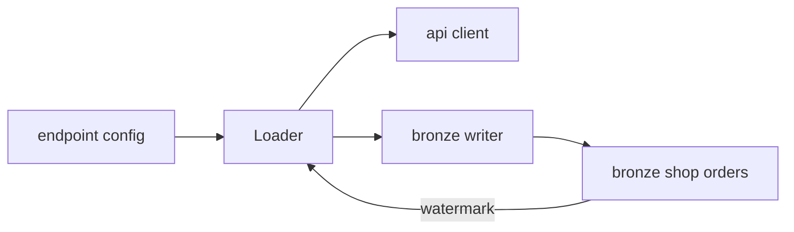

# Design rules

The design says how the requirements will be met: contracts, decisions and trade-offs. It is written so the plan can split it and the build can follow it without the chat.

## Rules

- **What, not how.** Contracts, decisions and trade-offs. No code, except the contract schema.
- **Density follows the boundary.** A full block for what creates a new boundary: a new table, a changed contract, a new source, a shared utility. What follows an existing pattern gets one line ("follows `mart_sales_by_channel`").
- **Only what belongs to this item.** Errors, tests, security and performance record only what is specific here. The project standard lives in `docs/` and is pointed to, not copied. Nothing is repeated across sections.
- **Stack only if it changes.** A new dependency comes with its version and its role.
- **Explicit types.** No schema inference in production. A JSON or variant column needs a written reason.
- **Failure is an explicit decision.** Each **If** requirement says which: fail the load, send the row to quarantine, or continue with an alert.
- **The spec stands alone.** The discovery is background. Conclusions the spec relies on are repeated in it.
- **Requirement ids in parentheses** after the decision that meets them: "Upsert by `order_id` (R1, R3)."

## Sections

**Contract changes.** One block per table created or changed:

```
Contract: marts.mart_sales_by_region (new; lives in the model YAML with contract: enforced)

| Column | Type | Null | Meaning |
|---|---|---|---|
| region_name | varchar | no | store region valid at sale time; UNKNOWN if unmatched |
| sale_date | date | no | |
| gross_amount | numeric(18,2) | no | gross, in the store currency |

Grain: region × day. Key: (region_name, sale_date). Partition or materialization: incremental by sale_date.
PII class: none. Freshness: D-1 by 08:00.
```

Say where the contract lives, as the stack profile defines it (for example the dbt model YAML, or a schema file next to the job). The build changes it in the same PR as the code.

**Approach.** The decisions, each with the requirements it meets.

**Load semantics** (when data is loaded): full or incremental, cursor or watermark and where it is read from, idempotency, late data, deletes, backfill.

**Quality checks.** Runtime checks on the data, each with a severity:

```
- unique(region_name, sale_date): error
- reconciliation vs fct_orders, last 7 days: error (R2)
- UNKNOWN share above 1% of daily amount: warn (R5)
```

Severity goes up, never down, unless the spec says why.

**Privacy.** Only if the item touches personal data: which columns, which class, masking or pseudonymization, who may read.

**Boundaries.**
- **Always:** what the build always does here.
- **Ask first:** what needs the user before doing (a new dependency, a change to a shared module, running in production).
- **Never:** what must not happen (real payloads in tests, a `DISTINCT` downstream to hide duplicates).

## Diagrams

Only when they help: three or more components interacting, a flow with branches, or a model with non-trivial relations. The text does not repeat the diagram; it states only the decision the diagram does not show.

Mermaid rules (for every Orcastrator diagram):
- no styling, structure only;
- node ids use only letters, digits and `_`;
- labels are plain text without `( ) [ ] " /`; technical detail goes in the text next to it.


